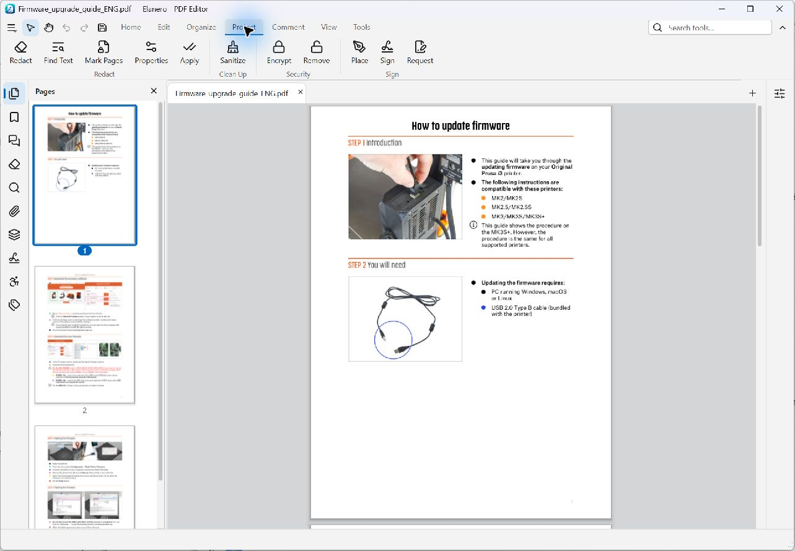
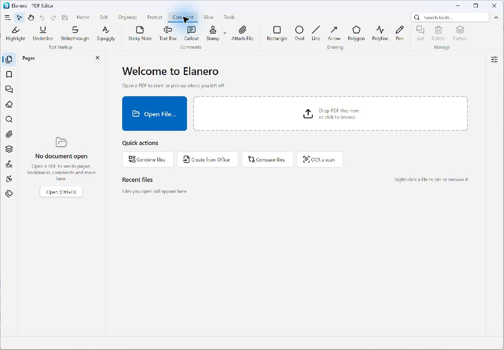
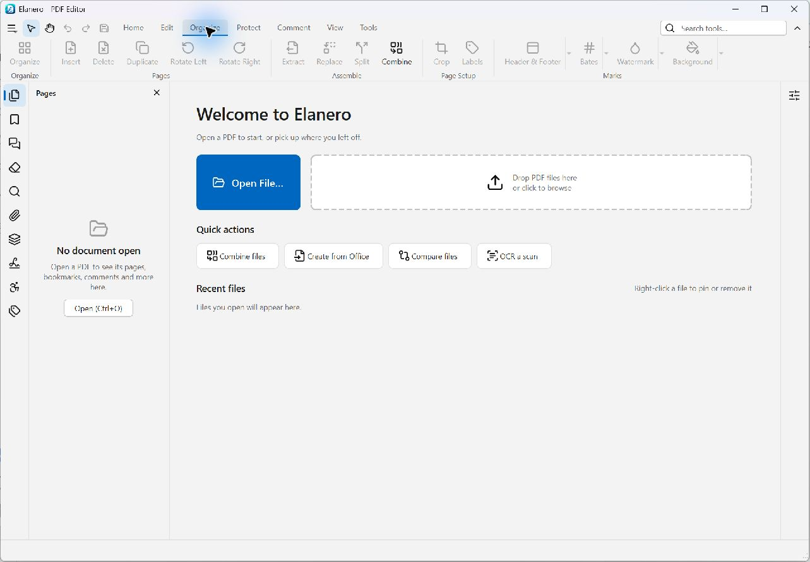
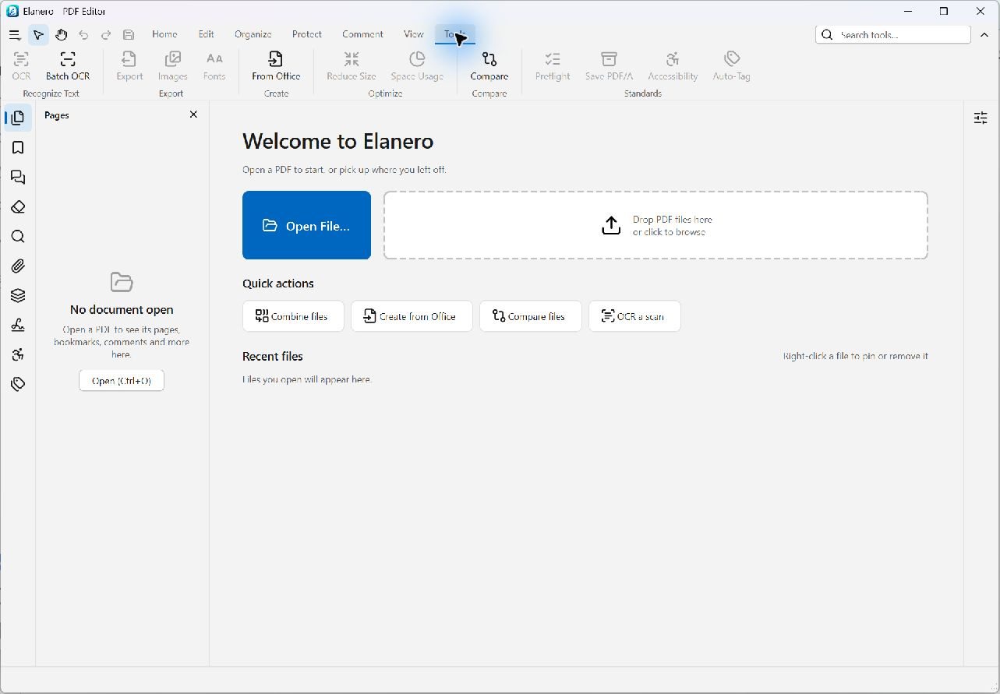

# Elanero - PDF Editor

Elanero is a free, open-source desktop PDF editor for Windows. Read and search documents,
edit text and images, review with comments, organize pages, recognize scanned text, redact
sensitive content, convert files, and sign documents digitally—all on your own computer.

No account, subscription, advertising, or telemetry. Document processing happens locally.
See [Privacy](#privacy) for the optional network connections.

[Download](#download-and-install) · [Features](#features) · [Digital signing](#digital-signing)
· [Screenshots](#screenshots) · [Limitations](#limitations-and-feature-status)
· [Contributing](#contributing)

## Download and install

**Supported packaged platform:** Windows 10 version 1809 or later, or Windows 11, **x64**.
Allow about 250 MB of free disk space. A keyboard and mouse or touchpad are recommended.
The project currently ships Windows builds; macOS and Linux packages are not provided.

- **Microsoft Store:** search for **Elanero - PDF Editor**, published by **SGN Solutions**.
- **GitHub Releases:** open the [releases page](https://github.com/linguagraph/pdf-editor/releases)
  and choose a release's `Elanero.exe` (portable) or `pdfeditor-<version>-setup.exe` (installer).
- **Development builds:** pull-request and `main` builds publish executable artifacts in
  [GitHub Actions](https://github.com/linguagraph/pdf-editor/actions). These are development
  snapshots rather than tagged releases.

The packaged app includes its Python runtime and core PDF, OCR, export, and signing
components. You do not need to install Python or Tesseract to use it. Office-to-PDF import
is an optional integration that requires LibreOffice; see [Conversion](#export-and-conversion).

### First steps

1. Open a PDF with **Open File**, drag it onto the welcome screen, or use Explorer's **Open with**.
2. Use **Home** to read and search, **Edit** to change content, **Comment** to review,
   **Organize** to work with pages, **Protect** for redaction/security/signing, or **Tools**
   for OCR, conversion, comparison, optimization, and checks.
3. Save your work or use Save As to keep a separate copy.

Press **Ctrl+Shift+P** to find commands by name, **Ctrl+K** for Preferences, and **Esc** to
return to the Select tool. **File → New Window** (**Ctrl+N**) opens another window.

## Features

### Reading, navigation, search, and printing

- Tabbed documents and separate windows, recent files with previews, and pinned recent files.
- Single-page, continuous, two-page, and two-page-cover layouts; fit page, fit width,
  actual size, zoom presets, and Ctrl+wheel zoom.
- Page thumbnails, page labels, bookmarks, internal links, navigation history, and page jumping.
- Attachment extraction and optional-content layer visibility controls.
- Text selection and copying; full-document search with case-sensitive, whole-word, and
  regular-expression options, contextual results, and next/previous navigation.
- Print preview, page ranges, scaling, and optional comments. Vector printing is used where
  supported; grayscale, image printing, and unsupported vector effects use a raster path.
- Light and dark themes, night-reading inversion, customizable keyboard shortcuts, and a
  searchable command palette.
- Document properties for metadata, fonts, PDF version, and security information.

### Text, images, and page content

- Edit existing text at paragraph level and add new text with font, size, color, alignment,
  and line-spacing controls.
- Reuse suitable document fonts or choose installed fonts. The font picker shows document,
  recent, standard, and installed fonts, with embedding restrictions and glyph coverage taken
  into account. Original fonts are retained where possible; substitutions are disclosed.
- Move, resize, replace, delete, or export existing images; add PNG/JPEG images.
- Add rectangles, ellipses, and lines as page content, distinct from review annotations.
- Select, move, and delete page objects, with undo/redo for editing operations.
- Inspect document fonts and their use. Fonts embedded by Elanero are subset on ordinary
  saves where applicable to avoid unnecessarily large files.

### Comments and review

- Highlight, underline, strike through, and squiggly-underline text.
- Sticky notes, text boxes, callouts, freehand ink, lines, arrows, rectangles, ellipses,
  polygons, polylines, and file-attachment annotations.
- Standard stamps and custom PNG/JPEG image stamps.
- Select, move, resize, copy/paste, and delete annotations; adjust applicable colors, fills,
  opacity, borders, text properties, author, subject, and locking.
- A Comments panel with replies, review status, filters by type/author/page, and page navigation.
- Comment-summary export to PDF/CSV and annotation exchange through XFDF import/export.
- Flatten selected annotations or all annotations when their appearances should become part
  of the page.

### Pages and document assembly

- Thumbnail-grid organization with multiple selection and drag-and-drop reordering.
- Insert blank pages, pages from PDFs, images, or a clipboard image; duplicate, delete,
  rotate, replace, and extract pages.
- Combine files with previews, ordering, page ranges, password unlocking, and merged bookmarks.
- Split by page count, page ranges, top-level bookmarks, or file size.
- Crop using margins and page ranges, including automatic white-margin removal.
- Create PDFs from images or multiple files.
- Edit page labels and bookmarks, including nesting and destinations.
- Add, update, and remove headers/footers, page numbers, Bates numbering, text/image
  watermarks, and backgrounds. Controls include placement, fonts, opacity, and page ranges
  where applicable.

### Redaction, sanitizing, and password protection

- Mark text, areas, or whole pages for permanent redaction; review marks before applying them.
- Search-and-redact presets for email addresses, phone numbers, IBANs, credit-card numbers
  with Luhn checks, US SSNs, dates, and custom regular expressions.
- Redaction removes affected content and runs a verification pass for residual text/image
  data. Saving redactions uses a full rewrite so old content is not kept in earlier revisions.
- Sanitize selected categories of hidden data, including metadata/XMP, scripts/actions,
  attachments, hidden layers, hidden/off-page text, comments, form data, links, and thumbnails.
- AES-256 or AES-128 encryption, user/owner passwords, and print/copy/edit/comment permissions.
- Remove security with the owner password; inspect security in Document Properties.
- Edit metadata with synchronization between the Info dictionary and XMP.

### OCR and scanned documents

- Recognize scanned pages using the built-in Tesseract engine, adding searchable, selectable
  text while retaining the visible scan.
- English language data is bundled; download additional languages from the OCR dialog.
- Select page ranges, skip pages that already contain text, and cancel recognition jobs.
- Optional scan cleanup for recognition, including grayscale, denoising, binarization, and
  deskewing; the searchable-text workflow keeps the visible image unchanged.
- Batch OCR for multiple files.

### Export and conversion

| Output or task | Available options |
| --- | --- |
| Word (`.docx`) | Keep page layout or use flowing text; includes styled text, tables, and pictures |
| Excel (`.xlsx`) | Detect and choose tables; each chosen table becomes a worksheet |
| HTML, Markdown, plain text | Structured text extraction with supported headings, tables, and images |
| PNG, JPEG, TIFF | Page ranges, DPI, RGB/grayscale, and optional comments; TIFF supports multiple pages |
| Extract resources | Export document images and fonts |
| Office files to PDF | Optional conversion through an installed LibreOffice copy |

PDF-to-Office conversion reconstructs editable content from a fixed-layout document; review
the result, especially for complex layouts and tables. Core exports run in the app without
Office, LibreOffice, or a separate conversion service.

### Optimization and document comparison

- Audit space usage by images, fonts, page content, annotations/forms, tags, attachments,
  metadata, and other document structures.
- Reduce file size with lossless, screen, ebook, print, or custom settings; estimate the
  result before writing a new file.
- Downsample/recompress images, subset fonts, remove unused/duplicate objects, and compress
  document streams. Optional linearization prepares unencrypted files for fast web viewing.
- Compare versions with page alignment, word-level text changes, and visual differences
  for pages whose text is unchanged.
- Review changes in synchronized side-by-side views and export a comparison-report PDF.

### PDF/A and document accessibility

- Built-in PDF/A preflight checks and conversion to PDF/A-2b, including sRGB output intent,
  XMP identification, supported font embedding, and removal of disallowed features.
- Conversion writes a separate file and reports remaining conformance problems. Built-in
  checks cover common rules; optional **veraPDF**, when installed, provides full validation.
- Accessibility checks for tagging, document language/title, image alternative text, heading
  structure, reading order, tab order, and text/annotation contrast.
- Fix supported document properties and alternative text; inspect, rename, and reorder tags
  in the Tags panel.
- **Experimental auto-tagging** for paragraphs, headings, and figures. It does not yet create
  complete list, table, or link structures, or supply image alternative text.

## Digital signing

Elanero supports visible and invisible **PAdES baseline B-B** signatures and optional
**B-T** signatures using an RFC 3161 timestamp server you choose.

| Certificate source | Status and requirements |
| --- | --- |
| PFX/P12 certificate file | Implemented and tested with RSA and ECDSA keys |
| Windows certificate store | Implemented, tested with software keys, and used with the owner's StampIT token; USB tokens/smart cards need their vendor middleware |
| Vendor PKCS#11 module | Implemented, but real-token/SoftHSM validation remains pending; see the roadmap |

- Use **Protect → Sign** to place a signature or sign a document. Visible appearances include
  the signer name, date, and optional reason/location.
- Signing writes an incremental update and verifies the output, including earlier signatures.
  Document certification, field locks, encryption permissions, and certificate suitability
  can restrict signing.
- **Request Signatures** places a named signature field for each recipient and saves a
  `-for-signature.pdf` copy. You attach and send the file yourself; Elanero does not send it,
  track recipients, or send reminders.
- The **Signatures panel** reports signature integrity, trust, changes after signing,
  signing-time information, certificate details, and available signed revisions.
- Signature inspection works offline and does **not** check certificate revocation or fetch
  certificates. Trust and integrity results are not a guarantee of legal status.

The [signing roadmap and manual checklist](PLAN.md) (Phase S)
record remaining hardware/interoperability checks. The Signatures panel still has pending
real-document/trust-store verification, and requested signature fields have not yet completed
the documented Acrobat interoperability check. RSA-PSS and adding long-term validation data
for B-LT/B-LTA are outside the current implementation.

## Privacy

Elanero has no accounts, telemetry, analytics, advertising, or automatic crash-report uploads.
Documents and their processing stay on your computer. Preferences, recent files, recovery
copies, logs, custom stamps, downloaded OCR languages, and the font index are stored locally.

Network access is user initiated: downloading OCR language data from GitHub, opening links
in your browser, or requesting a trusted timestamp when signing. Timestamping sends a hash
of the signature to the server you choose, rather than the PDF. Signature inspection itself
works offline.

Uninstalling the Store app removes its settings, recovery copies, and downloaded languages.
Installer/portable data remains in `%LOCALAPPDATA%\pdfeditor` until removed.
Read the full [privacy policy](PRIVACY.md) for details.

## Screenshots

Elanero on Windows with a PDF open and the document signing controls visible. This image
shows the signing tools, rather than a completed signature.



The following ribbon views show the welcome screen; document-dependent controls are disabled
until a PDF is open.

### Comments and markup



### Page organization



### OCR, conversion, and other tools



## Limitations and feature status

- **Existing forms:** rendering and preservation are in scope; general AcroForm creation and
  editing are not. Digital-signature fields have their own supported workflow.
- **PDF editing:** results depend on the source document's content and fonts; exact font reuse
  is not always possible. FreeText comments use standard fonts. Existing images do not yet
  have a rotation handle in the UI.
- **Scans:** OCR can make mistakes. Recognition does not promise to match the scan's original font.
- **Standards:** built-in PDF/A checks are not a complete validator. Accessibility checking and
  experimental tagging do not guarantee an accessible or standards-compliant document.
- **Signing:** see the specific validation and interoperability limits above. Closing the app
  during a Windows/token PIN prompt cannot terminate that prompt; the process waits for it
  to be answered or dismissed.
- **Outside current scope:** cloud sync, general form authoring, measurement tools,
  3D/multimedia editing, and a batch Action Wizard.

See [PLAN.md](PLAN.md) for implemented work, partial items, and future plans. Some roadmap
entries include historical measurements or pending manual checks; they are not blanket
compatibility or performance guarantees.

## Project and development

Elanero is written in **Python 3.11+** with a **PySide6 / Qt 6** interface. PDF operations go
through an abstract engine layer, currently backed by **PyMuPDF**. The internal package name
is `pdfeditor`, and the Windows executable is `Elanero.exe`.

The architecture separates UI, services, document sessions/commands, the PDF engine, and
model types. Editing uses undoable commands; saving writes and verifies a temporary output
before replacement. Tests cover engine contracts, services, GUI behavior, and save/reopen
round trips, with independent PDF parsing/rendering checks using pikepdf and pypdfium2.

### Run from source

From a clone of this repository, with [uv](https://docs.astral.sh/uv/) installed:

```sh
uv venv --python 3.11 .venv
uv pip install -e ".[dev]"
uv run python scripts/make_fixtures.py
uv run python -m pdfeditor
uv run python -m pdfeditor path/to/file.pdf
```

The source setup is for development; the supported packaged desktop target remains Windows.

### Checks

```sh
uv run ruff check .
uv run ruff format --check .
uv run lint-imports
uv run mypy
uv run pytest
```

GUI tests use pytest-qt. Headless environments need `QT_QPA_PLATFORM=offscreen`.
See [AGENTS.md](AGENTS.md) for architecture, testing, signing, and contribution conventions.

### Build and diagnose the Windows app

```sh
uv pip install -e ".[build]"
uv run python scripts/build_exe.py --test
uv run python scripts/build_exe.py --skip-build --clean-env
uv run python scripts/build_exe.py --installer
```

The first build writes `dist/Elanero.exe` and runs its self-test. Installer builds need
Inno Setup 6; MSIX and code-signing builds need the corresponding Windows packaging tools
and identity/certificate configuration. See [RELEASING.md](RELEASING.md) for packaging,
release tags, Store submissions, and source-distribution requirements.

To diagnose an installed portable executable:

```powershell
.\Elanero.exe --self-test --self-test-report report.txt
```

## Contributing

[Bug reports and feature requests](https://github.com/linguagraph/pdf-editor/issues) are
welcome, as are pull requests. For a bug, include the app version/channel, Windows version,
steps to reproduce, expected/actual behavior, and a non-sensitive sample PDF if you can share
one. Review logs and reports before sharing them.

Consult [PLAN.md](PLAN.md) before starting a larger feature and follow [AGENTS.md](AGENTS.md).
Useful contributions include real-world PDF compatibility reports, UI improvements,
documentation, and testing the documented signing workflows.

## License

Elanero is free software under **GNU AGPL-3.0-or-later**; see [LICENSE](LICENSE). The default
PDF backend, PyMuPDF, is also AGPL. **Help → About** lists bundled third-party components
and their licenses and provides the source-code offer.

